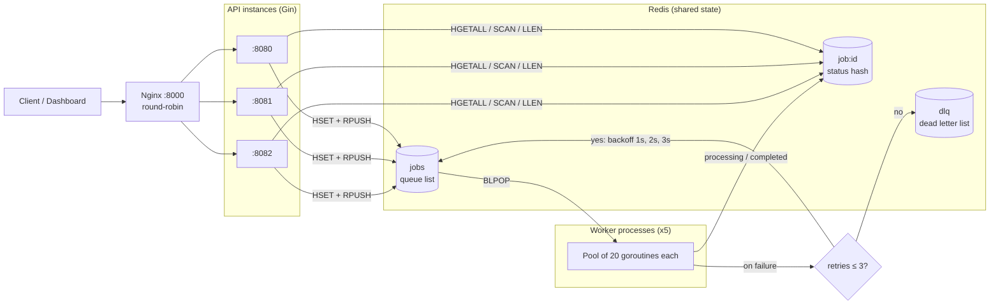
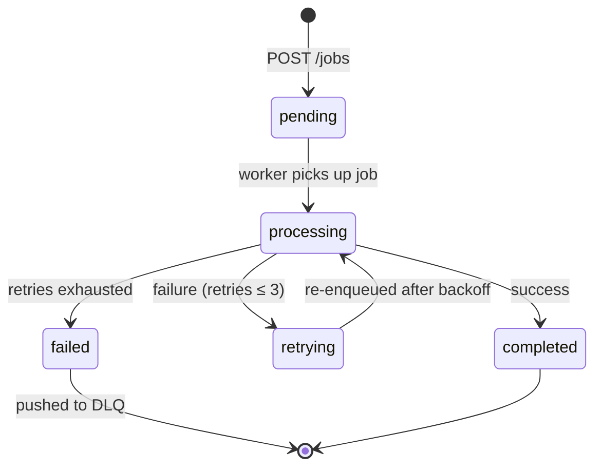

# Distributed Job Queue Service (Go)

## Overview

This project is a distributed job processing system built in Go. It demonstrates how to design and scale a backend system using a queue-based architecture with horizontal scaling, load balancing, and fault tolerance.

The system accepts jobs via an API, queues them in Redis, processes them asynchronously using worker pools, retries failures with backoff, isolates permanent failures in a Dead Letter Queue, and exposes live metrics through both a JSON endpoint and a built-in monitoring dashboard.


---

## Architecture

```
Client → Nginx Load Balancer → Multiple API Instances → Redis Queue → Worker Processes → Job Results
```

### System Diagram



### Job Lifecycle



All API instances and workers are stateless. Job state lives entirely in Redis, so any instance can serve any request and any worker can process any job.

---

## Features

- REST API for job submission and status tracking
- Redis-backed FIFO job queue
- Worker pool with concurrent processing
- Horizontal scaling for API and workers
- Load balancing using Nginx (round-robin)
- Retry mechanism with non-blocking linear backoff (up to 3 retries per job)
- Dead Letter Queue (DLQ) for persistent failures
- Metrics endpoint for monitoring system state (including retrying jobs)
- Built-in monitoring dashboard with live health of every API instance
- Interactive API explorer (Swagger-style) in the dashboard
- Built-in failure simulation to test retry and DLQ behavior on demand

---

## Tech Stack

- Go (Golang)
- Gin (HTTP framework)
- Redis (queue and storage)
- Nginx (reverse proxy and load balancer)
- Vanilla HTML/CSS/JS dashboard, embedded into the Go binary with `go:embed`

---

## Project Structure

```
job-service/
├── cmd/
│   ├── api/
│   │   └── main.go
│   └── worker/
│       └── main.go
├── internal/
│   ├── handler/
│   ├── queue/
│   │   ├── queue.go
│   │   ├── retry.go
│   │   └── dlq.go
│   ├── worker/
│   ├── metrics/
│   ├── db/
│   ├── model/
│   └── web/
│       ├── dashboard.html
│       └── web.go
├── pkg/
│   └── utils/
├── nginx/
│   └── nginx.conf
├── docs/
│   └── dashboard.png
├── Dockerfile (optional)
└── docker-compose.yml (optional)
```

---

## Getting Started

### Prerequisites

- Go installed
- Redis running locally
- Nginx installed

### Configuration

| Variable | Default | Description |
|---|---|---|
| `PORT` | `8080` | Port the API instance listens on |
| `REDIS_ADDR` | `localhost:6379` | Redis address |
| `FAIL_RATE` | `0.05` | Worker only: probability that a job fails randomly (when the job did not request a specific failure count). Use `0` for clean test runs |

---

## Running the System

### 1. Start Redis

```bash
redis-server
```

---

### 2. Start API Instances (Horizontal Scaling)

```bash
PORT=8080 go run cmd/api/main.go &
PORT=8081 go run cmd/api/main.go &
PORT=8082 go run cmd/api/main.go &
```

---

### 3. Start Worker Processes

```bash
for i in {1..5}; do go run cmd/worker/main.go & done
```

Each worker process runs a pool of 20 concurrent workers. Jobs are consumed in FIFO order.

---

### 4. Configure Nginx

```nginx
events {}

http {
    upstream backend {
        server 127.0.0.1:8080;
        server 127.0.0.1:8081;
        server 127.0.0.1:8082;
    }

    server {
        listen 8000;

        location / {
            proxy_pass http://backend;
        }
    }
}
```

Reload Nginx:

```bash
nginx -t
nginx -s reload
```

---

## Monitoring Dashboard

Open **http://localhost:8080/** (or any API instance, or `http://localhost:8000/` through Nginx).

The dashboard is a single HTML file embedded in the API binary, so there is nothing extra to deploy.

**What it shows**

- **Instance health:** one indicator per API instance with response time, plus an overall status ("All 3 instances healthy", "2 of 3 instances healthy")
- **Pipeline view:** live distribution of jobs across pending, processing, retrying, completed, and failed
- **Key indicators:** success rate, throughput (jobs per second), DLQ size, and a queue-depth sparkline
- **API explorer:** expand any endpoint, press Execute, and see the live JSON response and latency. `POST /jobs` rotates across healthy instances and reports which one served the request (`served_by`)

**Options**

| URL | Behavior |
|---|---|
| `/?ports=9000,9001` | Monitor a custom set of API ports (default `8080,8081,8082`) |
| `/?demo` | Run with simulated data, for previewing the UI without a backend |

**Cross-origin note:** the dashboard is served by one instance and queries the others directly, so every API instance must allow CORS. Add this middleware in `cmd/api/main.go`, right after `r := gin.Default()`:

```go
r.Use(func(c *gin.Context) {
    c.Header("Access-Control-Allow-Origin", "*")
    c.Header("Access-Control-Allow-Methods", "GET, POST, OPTIONS")
    c.Header("Access-Control-Allow-Headers", "Content-Type")
    if c.Request.Method == "OPTIONS" {
        c.AbortWithStatus(204)
        return
    }
    c.Next()
})
```

And serve the dashboard from the root route:

```go
r.GET("/", func(c *gin.Context) {
    c.Data(200, "text/html; charset=utf-8", web.Dashboard)
})
```

---

## API Endpoints

### Health Check

```
GET /health
```

Response:

```json
{
  "status": "ok",
  "port": "8080"
}
```

---

### Create Job

```
POST /jobs
POST /jobs?fail=N
```

The optional `fail` parameter makes the job fail exactly `N` times before it is allowed to succeed. It exists to test retry and DLQ behavior (see [Testing Retries and the DLQ](#testing-retries-and-the-dlq)).

Response:

```json
{
  "job_id": "3f0c2a58-9d2e-4a54-8c1e-2b6b0a1f7d90"
}
```

---

### Get Job Status

```
GET /jobs/:id
```

Example response for a job that recovered after two failures:

```json
{
  "status": "completed",
  "retries": "2",
  "fail_times": "2",
  "last_error": "simulated failure on attempt 2"
}
```

---

### Metrics

```
GET /metrics
```

Example response:

```json
{
  "total_jobs": 1000,
  "pending_jobs": 0,
  "processing_jobs": 0,
  "retrying_jobs": 0,
  "completed_jobs": 990,
  "failed_jobs": 10,
  "dlq_size": 10
}
```

Metrics are computed from shared Redis state, so every API instance returns the same numbers. The counters always add up: `total_jobs` is the sum of all five status counters.

---

## Retry and Dead Letter Queue Behavior

- A failed job is retried up to **3 times**, so each job gets at most **4 attempts**
- Retries use a linear backoff of 1s, 2s, then 3s
- Backoff is non-blocking: the delay is scheduled with a timer, so a failing job never occupies a worker slot while it waits
- The retry count is stored in the job's own Redis hash, so no extra keys are created
- After the final failed attempt, the job is marked `failed` and its ID is pushed to the `dlq` list in a single atomic transaction

---

## Testing Retries and the DLQ

Start workers with random failures disabled so only deliberate failures appear:

```bash
FAIL_RATE=0 go run cmd/worker/main.go
```

Create jobs that fail a controlled number of times:

```bash
A=$(curl -s -X POST "http://localhost:8000/jobs?fail=2"  | jq -r .job_id)   # retries, then succeeds
B=$(curl -s -X POST "http://localhost:8000/jobs?fail=3"  | jq -r .job_id)   # succeeds on the last allowed attempt
C=$(curl -s -X POST "http://localhost:8000/jobs?fail=99" | jq -r .job_id)   # exhausts retries, goes to DLQ

sleep 20
for id in $A $B $C; do curl -s http://localhost:8000/jobs/$id; echo; done
redis-cli LRANGE dlq 0 -1
curl http://localhost:8000/metrics
```

| Request | Expected outcome |
|---|---|
| `?fail=2` | Fails twice, completes on attempt 3 (`retries: 2`) |
| `?fail=3` | Fails three times, completes on attempt 4 (`retries: 3`) |
| `?fail=4` or higher | Fails all 4 attempts, `status: failed`, job ID appears in the DLQ |
| no `fail` parameter | Random failure with probability `FAIL_RATE` per attempt |

---

## Load Testing

### Sequential

```bash
time for i in {1..1000}; do
  curl -s -X POST http://localhost:8000/jobs > /dev/null
done
```

### Parallel (Recommended)

```bash
seq 1000 | xargs -P 20 -I {} curl -s -o /dev/null -X POST http://localhost:8000/jobs
```

To see failed and verify status codes while testing, print them instead of discarding the output:

```bash
seq 1000 | xargs -P 20 -I {} curl -s -o /dev/null -w "%{http_code}\n" -X POST http://localhost:8000/jobs | sort | uniq -c
```

### Mixed Load (Retries and DLQ)

```bash
seq 200 | xargs -P 20 -I {} curl -s -o /dev/null -X POST "http://localhost:8000/jobs?fail=2"
seq 10  | xargs -P 10 -I {} curl -s -o /dev/null -X POST "http://localhost:8000/jobs?fail=99"
```

Expected result: all 200 retrying jobs recover, the 10 jobs that cannot succeed end up in the DLQ, and the dashboard shows a success rate of about 95%.

---

## Clearing Redis (for clean tests)

```bash
redis-cli FLUSHDB
```

Run this before each test so leftover jobs from earlier runs do not skew the counters.

---

## Key Concepts Demonstrated

- Horizontal scaling (multiple API instances)
- Load balancing (Nginx round-robin)
- Asynchronous job processing
- Worker pool concurrency
- Retry logic with non-blocking backoff and failure handling
- Dead Letter Queue (DLQ)
- Observability: health checks, queue metrics, and a live monitoring dashboard
- Failure injection for testing fault tolerance
- Distributed system design with stateless services and shared state

---

## Limitations

- No authentication or authorization
- No persistent storage beyond Redis
- No auto-scaling
- At-most-once delivery: a job popped from the queue is lost if its worker crashes mid-processing
- Retry backoff timers are held in memory, so a worker crash during a backoff delay loses that pending retry
- The dashboard metrics scan all `job:*` keys, which is fine for thousands of jobs but should be replaced with counters at larger scale

---

## Future Improvements

- Reliable queue pattern using `BLMOVE` into a per-worker processing list, with a reaper for stuck jobs
- Persist retry schedules in a Redis sorted set instead of in-memory timers
- Maintain status counters incrementally instead of scanning keys
- Add rate limiting
- Introduce monitoring (Prometheus, Grafana)
- Containerize with Docker
- Deploy with Kubernetes
- Add health checks for worker nodes

---

## License

MIT License